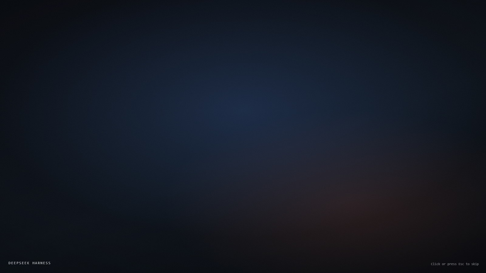

# dsh-boot-sequence

A configurable **boot sequence** for DeepSeek Harness (DSH): a full-screen layer that plays before the app UI — video and image phases in the order you choose — then fades to black and lets the app light up.

- Host-only: no client-side entries
- Paints before the app UI (injected into `<head>` while the index is rendered)
- Animates only `opacity` / `transform`
- Skippable at any time; honours `prefers-reduced-motion`; removes every node and style it added
- **Ships no third-party artwork**: the default backdrop is generated from CSS, and you supply your own video/images

## Install

```bash
dsh plugin --profile <name> add file:<absolute path to this repo>
```

Or use the desktop app: Settings → Plugins → enter the package name/path.

## Configuration

Edit `boot.config.json` in the package root and refresh the page — no restart needed (the host re-composes whenever the config changes).

```json
{
  "mediaBase": "/dsh-boot-sequence/media",
  "fadeMs": 600,
  "minShowMs": 1200,
  "oncePerSession": false,
  "skip": { "click": true, "keys": ["Escape", " ", "Enter"] },
  "ending": { "blackoutMs": 450, "holdMs": 250, "revealMs": 900 },
  "phases": [
    { "type": "video", "src": "intro.mp4", "fit": "cover", "duration": 12000 },
    { "type": "image", "src": "keyart.jpg", "duration": 1500 },
    { "type": "blank", "duration": 600 }
  ],
  "brand": { "show": false, "text": "DEEPSEEK HARNESS" },
  "hint": "Click or press Esc to skip"
}
```

### Fields

| Field | Default | Meaning |
|---|---|---|
| `phases` | `[{type:"blank",duration:1400}]` | Play order; `type` is `video`, `image` or `blank` |
| `phases[].src` | — | File name under `media/`; `/`-absolute and `http(s)` URLs also work |
| `phases[].fit` | `cover` | `cover` fills, `contain` letterboxes |
| `phases[].duration` | video 30s cap, image 2400ms | Phase length; video normally runs to `ended`, `duration` is the hard cap |
| `fadeMs` | 600 | Cross-fade between phases |
| `minShowMs` | 1200 | Minimum time on screen |
| `oncePerSession` | false | Play once per tab (`sessionStorage`) |
| `skip.click` / `skip.keys` | true / `Esc` `Space` `Enter` | How to skip; `click:false` disables click |
| `ending.blackoutMs` | 450 | Fade to black at the end |
| `ending.holdMs` | 250 | Time held on black |
| `ending.revealMs` | 900 | Fade-out that reveals the app |
| `brand` | off | Optional bottom-left text |
| `hint` | empty | Optional bottom-right skip hint |

## Media

```
media/
  intro.mp4      # your own video
  keyart.jpg     # your own image
```

- Supports `mp4/webm/mov`, `jpg/png/webp/avif/gif`
- Served at `/dsh-boot-sequence/media/<name>` with **HTTP Range** support
- Lookup order: the package `media/` first, then `~/.dsh/boot-sequence-media/` (recommended — survives reinstalls)
- Path traversal is rejected; only those two directories are readable
- For video, use `-movflags +faststart` so the first frame arrives sooner

## Diagnostics

```
GET /dsh-boot-sequence/health
→ {"ok":true,"plugin":"dsh-boot-sequence","version":"0.1.0","phases":["video","image"],"screenBytes":...}
```

## Self-test / preview

```bash
node tools/selftest.mjs   # mocked ctx: injection, health, media routes (200 / 206 / traversal 404)
node tools/preview.mjs    # writes dist/preview.html you can open in a browser
node tools/preview.mjs --config examples/video-then-image.json
```

## Design notes

- **No build artifacts**: `screen.css` + `runtime.js` + config are composed per render, so style edits apply immediately.
- **No inlined images**: media goes through a route; the injected script stays a few KB.
- **No complex timeline**: phases only cross-fade. Enough, and easy to maintain.
- **Fail silent**: if composition fails, nothing is injected and the app still starts.

## License

MIT. This repository contains no game or third-party artwork. Anything you place in `media/` is yours, and its rights remain with the respective owners.

## Screenshots



